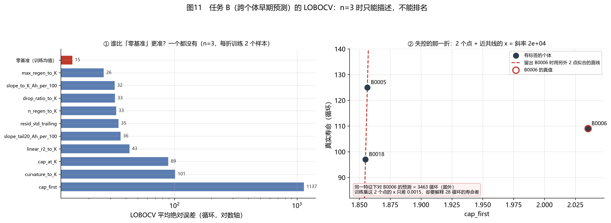

# 任务 B：跨个体早期预测的 LOBOCV（W12）

> 本文件由 `src/evaluate.py` 自动生成，数字随代码重算，**不要手工编辑**。

## 一、口径：任务 B 与任务 A 是两个问题

- **任务 A**（W9–W11 的 M1–M4）：给一块电池自己的前 M 个循环，外推它自己的后段。**逐个体拟合，没有「留一个体」这回事**。
- **任务 B**（本文件）：只看前 K 个循环的**特征**，预测**这块电池的寿命**。样本单位是**个体**，所以这里才用 LOBOCV（留一电池交叉验证）。
- `cycle` 在任务 B 里**不是**特征（会泄露），10 个特征全部来自 1..K 的窗口内信息。

- 有寿命标签的个体：**n = 3**；删失（无标签）的：B0007。
- 折数 = 3，**每折训练样本 = 2**。

## 二、结果：**没有一个特征模型赢过零基准**

| 特征                      |   平均绝对误差 |   最大绝对误差 |    平均斜率 |
|:------------------------|---------:|---------:|--------:|
| 零基准（训练均值）               |    14.67 |    22    |    0    |
| max_regen_to_K          |    26.36 |    61.33 | -614.27 |
| slope_to_K_Ah_per_100   |    32.46 |    57.24 |   11.27 |
| drop_ratio_to_K         |    32.58 |    57.93 |  -55.76 |
| n_regen_to_K            |    33.33 |    40    |   -8    |
| resid_std_trailing      |    34.88 |    68.75 |    7.73 |
| slope_tail20_Ah_per_100 |    36.25 |    57.07 |   -4.64 |
| linear_r2_to_K          |    42.83 |    97.27 |   46.62 |
| cap_at_K                |    88.77 |   231.24 | -512.7  |
| curvature_to_K          |   100.96 |   280.63 |  -10.07 |
| cap_first               |  1136.54 |  3353.6  | 6214.58 |

零基准（用另外 2 个个体的寿命均值去猜被留出的那个）平均绝对误差 **14.7** 循环；最好的单特征模型（max_regen_to_K）是 **26.4**，全部 10 个特征都更差。

这不是「特征没用」——**这是 n=3 时任何交叉验证都无法回答的问题**。每折只有 2 个训练点，一个 2 参数的线性模型刚好用 2 个点解出 2 个参数，训练误差**恒等于 0**（`linear_2pt` 里有断言：这是恒等式，不是拟合得好）。于是「模型在训练集上完美」在这里没有任何信息量，剩下全是外推运气。

## 三、最坏的那一折：2 个点 + 近共线的 x = 失控

最坏一行：用 cap_first 预测 **B0006**，预测 3463 循环、真值 109，误差 **+3354** 循环。

- 训练集两个点的 x 只差 **0.0015**（这 2 个点的寿命却差 28 循环）；
- 斜率因此达到 **18666.7 循环/单位特征**（该特征三折的平均斜率是 6214.6）；
- 被留出的那个个体 x 又落在训练区间外 **0.1788**，直线一外推就飞了。

这条与 W9 的 M2 是同一个病：**近共线的自变量 + 小样本 = 斜率不可辨识**。W9 里那叫「参数不可辨识」，这里叫「外推爆炸」，本质一样。

## 四、指标框架：这一轮新增了什么

| 组件 | 作用 | 自检 |
|---|---|---|
| `lobocv_folds` | 留一个体的折生成，断言每个体恰好留出一次 | 折覆盖 / 训练集不含留出者 |
| `linear_2pt` | 两点线性拟合，**显式断言训练残差恒为 0** | 恒等式被写成断言 |
| `lobocv_null` | 零基准（训练均值）——任何模型必须先赢它 | 预测值等于训练均值 |
| `coverage` / `mpiw` | PICP 覆盖率与平均区间宽度（W17 用） | 全覆盖 / 半覆盖 / 上界下界颠倒报错 |
| `to_common_schema` | 四个模型的表合并成统一列序 | **缺列直接报错，不许静默补 NaN** |

## 五、结论：任务 B 在这份数据上只能描述

1. **不给排名**：n=3、每折训练 2 个样本，任何排序都是噪声。报告里引用「哪个特征最好」时，必须同时给 n。
2. **不给 p 值当结论**：n=3 时相关系数的可视化区间是 [−1, 1]，W8 已经记过这件事（10 个特征 p 全 > 0.20）。
3. **可以说的是方向**：特征与寿命的**符号**在 W8 里做过描述性记录，那只能当假设，等更多电池数据才能验证。
4. **任务 A 的结论不受影响**：M1–M4 是逐个体拟合，不依赖跨个体的样本量。

## 六、这张表不能怎么读

1. **不能把「零基准最好」读成「机器学习没用」**：它读成的是「本数据只有 3 个有标签的个体，不够做跨个体学习」。
2. **不能拿训练误差证明模型好**：两点拟合的训练误差恒为 0（第三节）。
3. **不能把 LOBOCV 的误差当置信区间**：3 个数的均值没有方差可言，任何 `mean ± std` 在这里都不成立。
